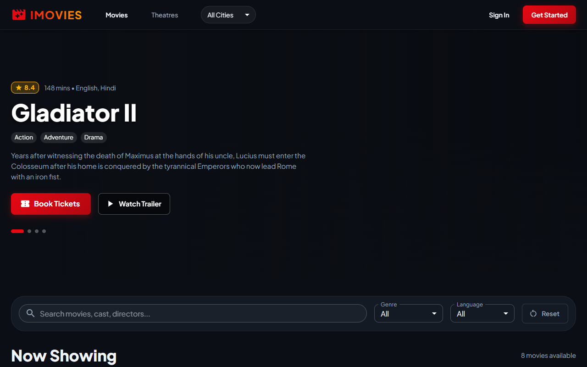
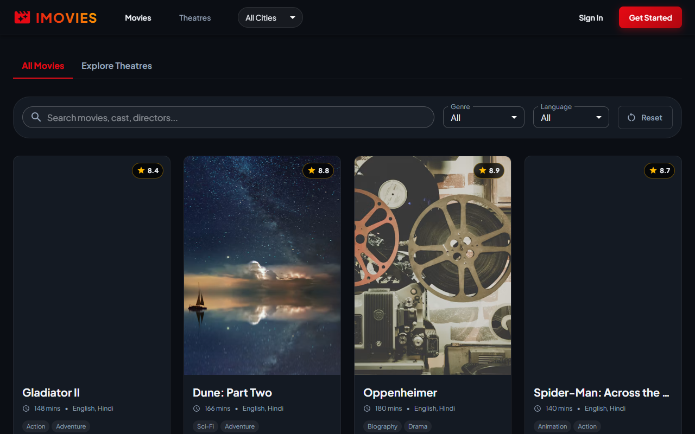
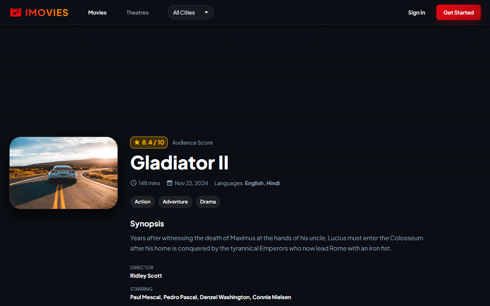
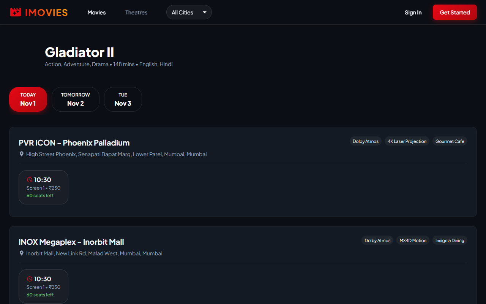
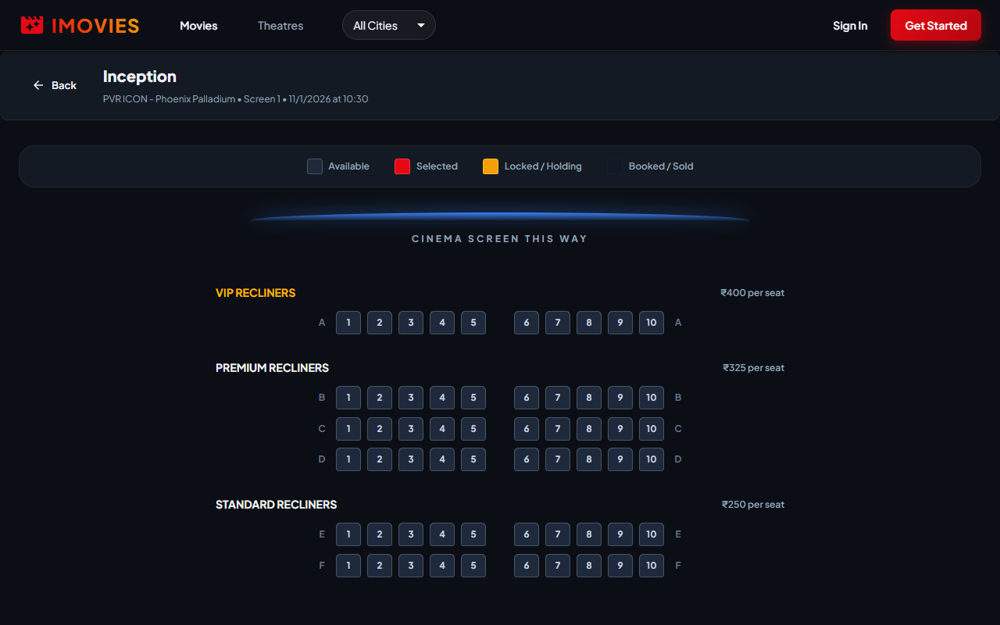
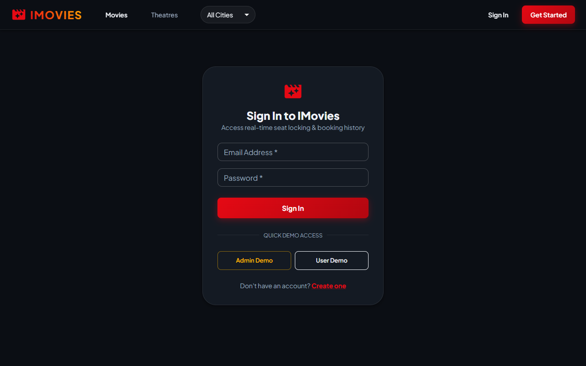
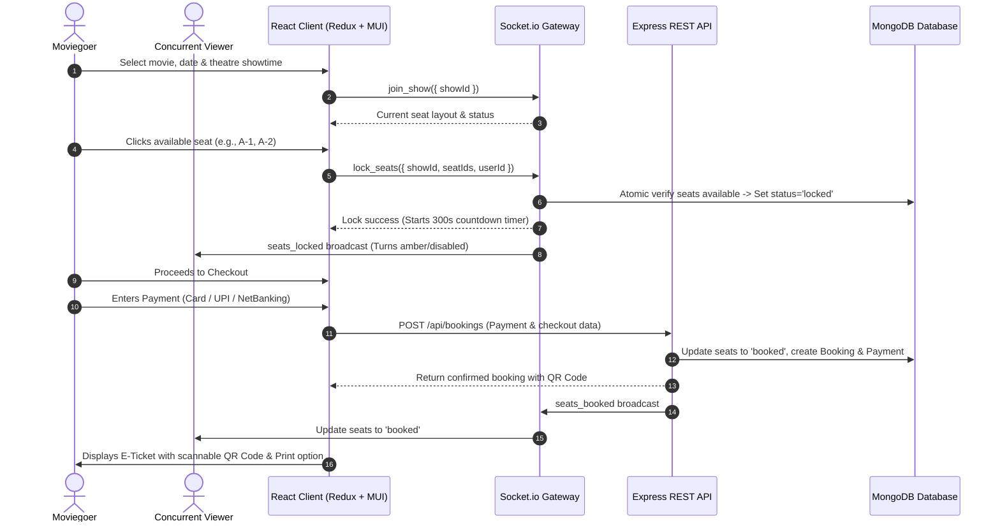

# 🎬 IMOVIES - Cinema Management & Ticket Booking System

[](https://react.dev)
[](https://socket.io)
[](https://mui.com)
[](https://www.mongodb.com)
[](https://opensource.org/licenses/MIT)

A modern, full-stack **Cinema Management and Ticket Booking System** engineered with the **MERN Stack** (MongoDB, Express.js, React.js, Node.js) and **Socket.io**. Designed for high concurrency, it delivers real-time temporary seat reservations, dynamic multi-tier theater screen visualization, interactive multi-method payment simulations, contactless QR-coded electronic tickets, and an administrative back-office console.

---

## 📸 Application Showcase

### 1. Home Page & Blockbuster Showcase
High-impact hero carousel featuring top-rated theatrical releases, video trailer integrations, instant book shortcuts, and a dynamic "Now Showing" catalog.


---

### 2. Movie Exploration & Dynamic Filters
Filter movies in real-time by genre (Action, Sci-Fi, Adventure, Drama, Thriller, etc.), audio language, screening city, or keyword search.


---

### 3. Movie Details & Trailer Player
In-depth film overview with audience ratings, director, full cast, synopsis, and direct transition to theatre scheduling.


---

### 4. Multi-Theatre Showtime Scheduling
Browse partner cinema chains (PVR, INOX, Cinepolis) across dates (Today, Tomorrow, Upcoming) with live available seat counters per auditorium.


---

### 5. Interactive Seat Map with Real-Time Locking
Interactive curved cinema screen, tiered seating (VIP, Premium, Standard), live status indicators, and an automated **5-minute temporary reservation lock** powered by Socket.io.


---

### 6. Authentication & Instant Demo Access
Secure JWT authentication with bcrypt password encryption and 1-click Demo credentials for rapid testing of Admin and Customer workflows.


---

## ⚡ End-to-End System Workflow



---

## 🏗️ Technical Architecture & Key Modules

### 1. Concurrency & Real-Time Seat Locking
- **Socket.io Show Rooms**: Each show maintains an isolated room (`show_${showId}`).
- **5-Minute Temporary Reservation**: When seats are picked, a server-side timer locks them for 300 seconds. If checkout is completed, seats become permanently `booked`. If the user disconnects or the timer expires, seats are auto-reverted to `available` and broadcast to all viewers.
- **Race Condition Prevention**: Database-level check ensures two users cannot select or pay for the same seat simultaneously.

### 2. Multi-Method Simulated Payment Processing
- **Supported Channels**: Credit/Debit Cards, UPI (VPA & Quick App selection), and Net Banking.
- **Decline Simulation Switch**: Includes a "Simulate Bank Decline" toggle allowing QA testers to verify graceful error handling and retry workflows.
- **QR Code E-Ticket**: Instant generation of scannable QR vouchers embedding booking reference, film, screen, and seat numbers.

### 3. Role-Based Access Control (RBAC)
- **Customer Role**: Browse, select seats, book tickets, receive in-app notifications, view booking history, and cancel tickets with automatic refund calculation.
- **Admin Role**: Comprehensive management portal:
  - **Movies**: Add new films with poster uploads/URLs, cast, synopsis, and rating.
  - **Theatres**: Register cinema properties, screens, and multi-tier pricing multipliers.
  - **Shows**: Schedule screenings with automatic seat map generation.
  - **Bookings**: Real-time revenue analytics and audit table of all customer transactions.

---

## 📦 Project Structure

```
IMOVIES/
├── .gitignore               # Strict git exclusion for secrets & build outputs
├── README.md                # Project documentation with embedded UI previews
├── package.json             # Root runner scripts (dev, seed, server, client)
│
├── docs/
│   └── screenshots/         # UI screenshots for documentation
│
├── server/
│   ├── .env.example         # Template for environment variables
│   ├── server.js            # Express app + HTTP server + Socket.io gateway
│   ├── config/
│   │   ├── db.js            # Mongoose MongoDB connection
│   │   └── socket.js        # Socket.io event handlers & seat lock timer manager
│   ├── models/
│   │   ├── User.js          # User & Admin credentials schema
│   │   ├── Movie.js         # Movies catalog schema
│   │   ├── Theatre.js       # Theatres & screen layouts schema
│   │   ├── Show.js          # Scheduled showtimes & seat matrices schema
│   │   ├── Booking.js       # Customer reservations & QR data schema
│   │   ├── Payment.js       # Financial transaction logs schema
│   │   └── Notification.js  # User notifications schema
│   ├── middleware/
│   │   ├── auth.js          # JWT verification & Admin RBAC guard
│   │   ├── rateLimiter.js   # express-rate-limit protection
│   │   ├── errorHandler.js  # Centralized error handler
│   │   └── upload.js        # Multer image storage configuration
│   ├── controllers/         # REST API business logic
│   ├── routes/              # Express API route declarations
│   ├── utils/
│   │   └── qrGenerator.js   # QR code generator for e-tickets
│   ├── seed/
│   │   ├── seedData.js      # Rich movie, theatre, and show seed data
│   │   └── seeder.js        # CLI database runner
│   └── tests/
│       └── apiTest.js       # Automated backend self-checks & assertions
│
└── client/
    ├── vite.config.js       # Vite configuration with API and WS proxy
    ├── index.html           # HTML template with Google Fonts
    └── src/
        ├── main.jsx         # App mounting with Redux Provider
        ├── App.jsx          # App routing and theme orchestration
        ├── theme/
        │   └── cinemaTheme.js # Custom MUI Dark Cinema theme
        ├── store/           # Redux Toolkit store and feature slices
        ├── services/        # Axios API client & Socket.io singleton
        ├── components/      # UI components (SeatGrid, TicketModal, etc.)
        └── pages/           # Customer pages & Admin console views
```

---

## 🚀 Getting Started

### Prerequisites
- **Node.js**: v16+ (tested on Node v22)
- **MongoDB**: Active local daemon (`mongodb://localhost:27017`) or MongoDB Atlas URI

### 1. Installation
Clone the repository and install dependencies for both server and client:
```bash
git clone https://github.com/Hatim-Rx53/IMOVIES.git
cd IMOVIES

# Install server dependencies
cd server
npm install

# Install client dependencies
cd ../client
npm install
```

### 2. Environment Configuration
Create a `.env` file in the `server/` directory (see `server/.env.example`):
```env
PORT=5000
MONGO_URI=mongodb://localhost:27017/imovies_db
JWT_SECRET=imovies_super_secret_jwt_key_2026_secured
NODE_ENV=development
CLIENT_URL=http://localhost:5173
```

### 3. Database Seeding
Populate the database with 8 blockbuster movies, 4 theatres with multiple screens, 60 scheduled showtimes, and ready-to-test accounts:
```bash
cd server
npm run seed
```

**Pre-configured Credentials:**
| Role | Email | Password | Permissions |
|---|---|---|---|
| **Administrator** | `admin@imovies.com` | `Admin@123` | Full CRUD for movies, theatres, shows, revenue audit |
| **Standard User** | `user@imovies.com` | `User@123` | Browsing, seat locking, checkout, cancellations |

---

## 💻 Running the Application

### Option A: Run Server & Client Simultaneously (Root)
From the project root:
```bash
npm run dev
```

### Option B: Run in Separate Terminals

#### Terminal 1 (Backend API & Socket.io):
```bash
cd server
npm start
```
*API running at `http://localhost:5000`*

#### Terminal 2 (React Frontend Client):
```bash
cd client
npm run dev
```
*Application available at `http://localhost:5173`*

---

## 🧪 Verification & Testing

Run the automated backend self-checks and database assertions:
```bash
cd server
npm run test:api
```

Build the production frontend bundle:
```bash
cd client
npm run build
```

---

## 🔒 Security Best Practices
- **Password Protection**: Passwords salted and hashed with `bcryptjs`.
- **JWT Authorization**: Stateless tokens validated on every secured route.
- **Brute-Force Mitigation**: `express-rate-limit` prevents brute-force login and API flooding.
- **Sanitized Git Tracking**: Environment files (`.env`), temporary uploads, and local builds are strictly excluded in `.gitignore`.

---

## 📄 License
This project is licensed under the MIT License - see the LICENSE file for details.
